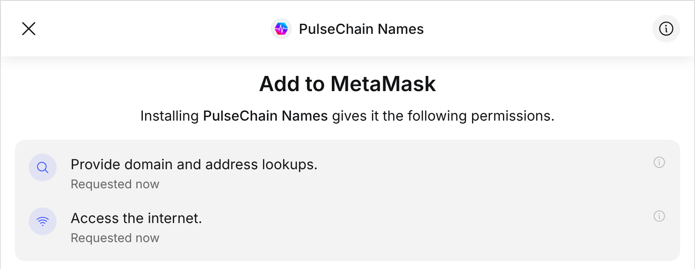
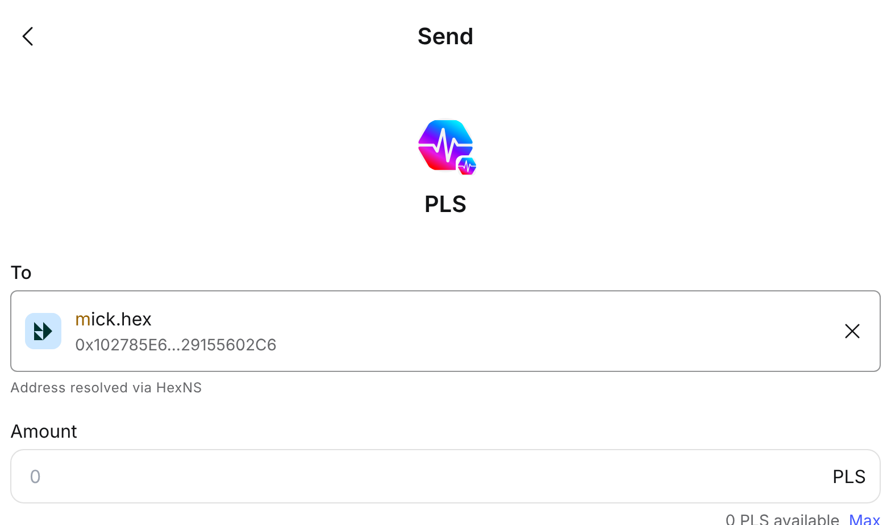

# PulseChain Names knowledge base

Step-by-step guides for using PulseChain Names, the MetaMask snap for `.hex`, `.pdai` and `.pls`
names, and fixes for common problems. Quick answers are in the [FAQ](FAQ.md). Still stuck?
[Ask for help](#ask-for-help).

**Getting started**
- [Install PulseChain Names](#install-pulsechain-names)
- [Add PulseChain to MetaMask](#add-pulsechain-to-metamask)
- [Send to a name](#send-to-a-name)
- [Send to a .hex name on Ethereum](#send-to-a-hex-name-on-ethereum)

**Your own name**
- [Get a name](#get-a-name)
- [Check your name points to your address](#check-your-name-points-to-your-address)
- [Set your primary name](#set-your-primary-name)

**Managing the snap**
- [Check which version you have](#check-which-version-you-have)
- [Pause or remove PulseChain Names](#pause-or-remove-pulsechain-names)

**Troubleshooting**
- [MetaMask doesn't show an address when I type a name](#metamask-doesnt-show-an-address-when-i-type-a-name)
- [It says "No address resolution found for this name"](#it-says-no-address-resolution-found-for-this-name)
- [A name works on PulseChain but not on Ethereum](#a-name-works-on-pulsechain-but-not-on-ethereum)
- [The address isn't the one I expected](#the-address-isnt-the-one-i-expected)
- [MetaMask highlights a letter in the name](#metamask-highlights-a-letter-in-the-name)
- [I don't see names next to addresses](#i-dont-see-names-next-to-addresses)
- [Lookups are slow, or only work sometimes](#lookups-are-slow-or-only-work-sometimes)

**Staying safe**
- [Check an address before you send](#check-an-address-before-you-send)
- [Watch out for support scams](#watch-out-for-support-scams)
- [What the lookup servers can see](#what-the-lookup-servers-can-see)

**[Ask for help](#ask-for-help)**

## Getting started

### Install PulseChain Names

You need MetaMask's browser extension on a computer.

1. Open the [MetaMask Snaps Directory](https://snaps.metamask.io) and search for **PulseChain
   Names**.
2. Click **Add to MetaMask**.
3. MetaMask asks to connect. Click **Connect**.
4. MetaMask shows what PulseChain Names can do: provide domain and address lookups, and access the
   internet, to read the blockchains. Click **Confirm**.

   

5. When MetaMask says **Installation complete**, click **OK**.

To use `.pdai` and `.pls` names, or `.hex` names on PulseChain, MetaMask also needs the PulseChain
network: see [Add PulseChain to MetaMask](#add-pulsechain-to-metamask).

PulseChain Names appears in the directory once MetaMask has reviewed and approved it. Until then,
it can only be installed in [MetaMask Flask](https://metamask.io/flask/), MetaMask's edition for
developers, by its npm name, `npm:pulsechain-names-snap`.

### Add PulseChain to MetaMask

1. In MetaMask, open the network menu.
2. Choose to add a network, then to add one manually.
3. Enter these details:

   | Field | Value |
   |---|---|
   | Network name | PulseChain |
   | RPC URL | `https://rpc.pulsechain.com` |
   | Chain ID | `369` |
   | Currency symbol | `PLS` |
   | Block explorer URL | `https://scan.pulsechain.com` |

4. Save, then switch MetaMask to **PulseChain**.

### Send to a name

1. In MetaMask, choose the **PulseChain** network, or **Ethereum** for a `.hex` name.
2. Click **Send**.
3. In the **To** box, type the whole name, ending included, such as `mick.hex`. Capital letters
   don't matter: `MICK.hex` finds `mick.hex`.
4. After a moment, MetaMask shows the address under the name, and which name service found it:
   "Address resolved via HexNS", "pDAI Name Service" or "Pulse Domains".

   

5. [Check the address](#check-an-address-before-you-send), enter the amount, and carry on as
   usual. You review and confirm the transaction in MetaMask, as with any send.

### Send to a .hex name on Ethereum

`.hex` names also work on Ethereum. Switch MetaMask to **Ethereum**, then
[send to a name](#send-to-a-name) as usual.

A `.hex` name is registered on PulseChain and copied to Ethereum, so a newly registered name works
on Ethereum once its copy arrives there. The HexNS app, [app.hexns.domains](https://app.hexns.domains),
shows each name's Ethereum copy on the name's page. `.pdai` and `.pls` names live on PulseChain only.

## Your own name

### Get a name

Names come from each name service's own website:

| Ending | Get one at |
|---|---|
| `.hex` | [hexns.domains](https://hexns.domains) |
| `.pdai` | [pdai.domains](https://pdai.domains) |
| `.pls` | [app.pulse.domains](https://app.pulse.domains) |

Each service sets its own prices and rules, and answers questions about buying, renewing or changing
names.

### Check your name points to your address

People can send to your name only if it points to your address. To check, without sending
anything:

1. In MetaMask, choose **PulseChain** and click **Send**.
2. Type your name in the **To** box.
3. Compare the address MetaMask shows with your own. Then leave the send screen.

If it shows a different address, or none, change where your name points on its name service's
website. On HexNS and pDAI Name Service, a name points to its owner unless the owner sets it
elsewhere.

### Set your primary name

A primary name is the name your address chooses for itself, so MetaMask can show it next to your
address. PulseChain Names shows it only if the name points back to the same address.

- **`.pls`:** set your primary name in the Pulse Domains app,
  [app.pulse.domains](https://app.pulse.domains).
- **`.hex` and `.pdai`:** these services don't have primary names yet. PulseChain Names already asks
  for them, so they'll show as soon as the services add them.

## Managing the snap

### Check which version you have

In MetaMask, open the menu (⋮), choose **Snaps**, then **PulseChain Names**. The version is listed
on its page. Regular MetaMask only installs versions that MetaMask has reviewed and approved.

### Pause or remove PulseChain Names

In MetaMask, open the menu (⋮), choose **Snaps**, then **PulseChain Names**:

- To pause it, switch **Enabled** off. Switch it back on at any time.
- To remove it, click **Remove PulseChain Names**, then **Remove Snap**. You can
  [install it again](#install-pulsechain-names) later.

## Troubleshooting

### MetaMask doesn't show an address when I type a name

Check these, in order:

1. **The snap is installed and on.** In MetaMask, open the menu (⋮), choose **Snaps**, and check
   **PulseChain Names** is listed with **Enabled** switched on. If it isn't listed,
   [install it](#install-pulsechain-names).
2. **MetaMask is on the right network.** `.hex`, `.pdai` and `.pls` names work on **PulseChain**.
   On **Ethereum**, only `.hex` names work. On any other network, PulseChain Names isn't asked.
3. **The name is typed in full, with its ending,** such as `mick.hex`, not `mick`. Check the
   spelling. Capital letters don't matter.
4. **The name exists and points to an address.** Look it up on its name service's website:
   [hexns.domains](https://hexns.domains), [pdai.domains](https://pdai.domains) or
   [app.pulse.domains](https://app.pulse.domains).
5. **Give it a few seconds.** A lookup can take a moment, longer if a server is slow and the snap
   has to try another.

### It says "No address resolution found for this name"

No name service could give an address for that name on this network. Usually it's one of these:

- The name isn't registered, or it has expired.
- The name is registered, but it doesn't point to an address.
- It's a `.pdai` or `.pls` name and MetaMask is on Ethereum. Switch to PulseChain.
- It's a `.hex` name that was registered very recently and MetaMask is on Ethereum: see
  [the next answer](#a-name-works-on-pulsechain-but-not-on-ethereum).

Check the name on its service's website. If it's registered there and points to an address, and
you're on the right network, please [ask for help](#ask-for-help).

### A name works on PulseChain but not on Ethereum

- `.pdai` and `.pls` names live on PulseChain only. That's how those services work.
- `.hex` names are registered on PulseChain and copied to Ethereum. A newly registered name works
  on Ethereum once its copy arrives there. The HexNS app,
  [app.hexns.domains](https://app.hexns.domains), shows each name's Ethereum copy on the name's
  page.

### The address isn't the one I expected

A name points wherever its owner has set it, and the owner can change that at any time. PulseChain
Names shows where the name points right now. See
[Check an address before you send](#check-an-address-before-you-send).

If you think a name service is giving the wrong answer, please [ask for help](#ask-for-help).

### MetaMask highlights a letter in the name

MetaMask marks letters that look like others, such as the `m` in `mick.hex` (`m` looks like `rn`),
to warn you about lookalike names. That's MetaMask's own safety check, not an error. Make sure the
name is exactly the one you meant.

### I don't see names next to addresses

PulseChain Names gives MetaMask a name for an address only if that address has chosen a primary
name, and the name points back to the same address. See
[Set your primary name](#set-your-primary-name).

### Lookups are slow, or only work sometimes

PulseChain Names reads the blockchains through public servers. If one is down or slow, it waits up
to 6 seconds, then tries the next. So a lookup can occasionally take a little longer, or fail if
every server is having trouble at once.

- Check your internet connection, and try again in a minute.
- Firewalls, VPNs and some browser extensions can block the servers it uses. Try without them.
- If it keeps happening, please [ask for help](#ask-for-help) and say which network you were on.

## Staying safe

### Check an address before you send

A name points wherever its owner sets it, and that can change. Before you send:

- Check the address with the person you're paying, another way, such as a message or a call. At
  least compare its first and last few characters.
- Check the name's spelling: a different name can look very similar.
- For large amounts, send a small test amount first.

Payments on a blockchain can't be reversed, so a minute spent checking is worth it.

### Watch out for support scams

- **Never share your recovery phrase or private keys,** with anyone, for any reason. Nobody working
  on PulseChain Names will ever ask for them, and anyone who does is trying to steal your funds.
- PulseChain Names support never messages you first, and never asks you to connect your wallet to a
  website or approve a transaction to "fix" anything.
- PulseChain Names is free. Never pay anyone for it.
- The only support channel is the [support form](#ask-for-help).

### What the lookup servers can see

Lookups read public records from the PulseChain and Ethereum blockchains, through public RPC servers
(PulseChain's own and publicnode.com first, with others as backups). Like any website you visit,
the server that answers sees the name or address you looked up, and your internet address. The snap
itself keeps no record of your lookups and sends nothing else anywhere.

## Ask for help

Use the [support form](https://github.com/mitchrobertshaw/pulsechain-names-snap/issues/new/choose)
(it needs a free GitHub account). Tell us the name or address you looked up, which network MetaMask
was on, and what MetaMask showed. A screenshot helps; cover anything private first.

**Never share your recovery phrase or private keys.**

For questions about a name itself, such as buying it, renewing it or changing the address it points
to, contact its name service: [HexNS](https://hexns.domains),
[pDAI Name Service](https://pdai.domains) or [Pulse Domains](https://app.pulse.domains).
